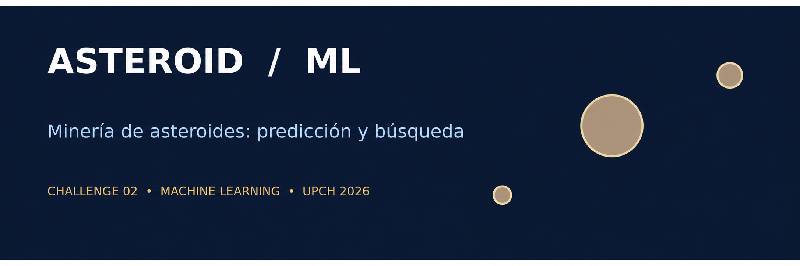
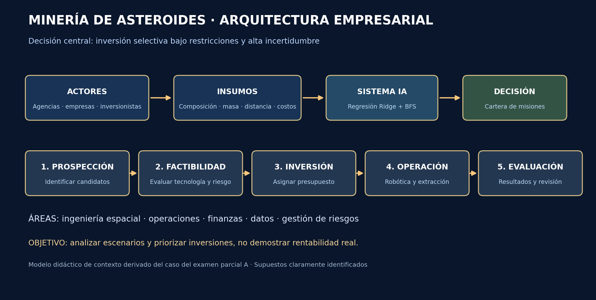
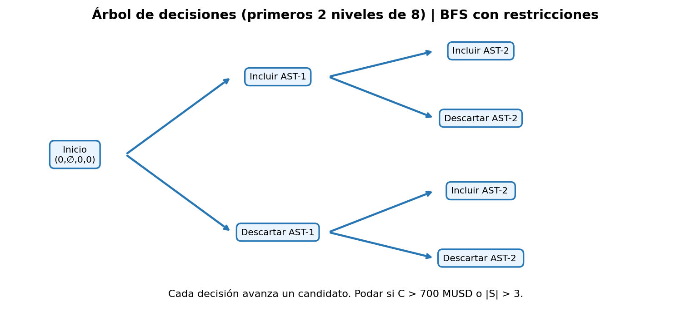

# 🚀 ASTEROID ML | Minería de asteroides



**Challenge 2 (Individual) · Pipeline de Machine Learning · UPCH · 2026-II**  
**Tema:** Tipo A — Minería de asteroides  
**Estudiante:** Cesar Rodrigo Milla Gomez  
**Docente:** Yannick Patrick Carrasco Merma

> **Origen del caso:** examen parcial A, sección III «Estudio de caso (Minería de asteroides)», fechado 05/10/2026. La pregunta de partida fue debatir si la humanidad debería invertir masivamente en minería de asteroides en los próximos años. El proyecto convierte esa discusión en un problema de **apoyo a decisiones de inversión**, no en una recomendación de invertir de forma masiva. Datos completamente sintéticos: las cifras no representan predicciones económicas reales.

## 🎯 1. Presentación del caso, problema y objetivos (5 puntos)
El caso del examen presenta la minería de asteroides como un mercado emergente, con empresas interesadas, robótica espacial, extracción y procesamiento de recursos, y grandes incertidumbres económicas y tecnológicas. Menciona recursos como platino, níquel, cobalto y tierras raras. La decisión empresarial es **dónde invertir primero y bajo qué restricciones**, considerando que aumentar inversiones no garantiza viabilidad. Las misiones tienen costos y riesgos distintos, de modo que la elección puede formularse mediante predicción y búsqueda de opciones.

**Pregunta del problema:** Dada la incertidumbre descrita en el examen, ¿cómo apoyar una **inversión selectiva y gradual** en minería de asteroides, estimando un beneficio económico hipotético por candidato y seleccionando combinaciones de misiones que respeten el presupuesto y el riesgo?

**Objetivo general:** diseñar un sistema demostrativo de apoyo a decisiones de inversión selectiva en minería de asteroides mediante Machine Learning y búsqueda, bajo restricciones explícitas.

**Objetivos específicos:** (1) estructurar un espacio de estados; (2) explorar opciones con búsqueda en anchura y poda; (3) entrenar y evaluar un modelo de regresión Ridge; (4) interpretar resultados con visualizaciones.

**Postura argumentada del caso:** se recomienda **invertir de manera gradual en investigación, prospección y demostradores**, antes de realizar una inversión masiva en explotación comercial. A favor están el potencial de recursos y el desarrollo tecnológico; en contra, la incertidumbre sobre rentabilidad, costos logísticos, seguridad, gobernanza y madurez técnica. El algoritmo sirve para comparar escenarios simulados, no para resolver por sí solo ese debate.

**Justificación:** Machine Learning permite identificar relaciones predictivas en datos numéricos, mientras que la búsqueda permite comparar decisiones combinatorias. La combinación contribuye al apoyo a decisiones, aunque el ejercicio requiere validación con datos físicos y financieros reales antes de cualquier aplicación práctica.

## 🏢 2. Arquitectura conceptual empresarial (vinculada al examen)



El **sector** reúne actores públicos, empresas de exploración, proveedores de sistemas robóticos, operadores de misiones e inversionistas. Los **procesos** comprenden prospección → evaluación de factibilidad → decisión de inversión → operación/extracción → evaluación de resultados. Las **áreas** involucradas incluyen ingeniería espacial, ciencia de datos, operaciones, finanzas y gestión de riesgos. El **objetivo empresarial** es elegir inversiones potencialmente atractivas sin superar restricciones, manteniendo incertidumbre explícita. Este diagrama responde al apartado «Diagrama de contexto o arquitectura conceptual» del examen parcial.

## 🧭 3. Espacio de estados (5 puntos)



| Elemento | Definición |
|---|---|
| Estado | `s=(i, S, C, U)` donde `i` = candidatos evaluados, `S` = índices seleccionados, `C` = costo acumulado, `U` = utilidad acumulada |
| Estado inicial | `s₀=(0, ∅, 0, 0)` |
| Operadores | `incluir` el siguiente candidato / `descartar` el siguiente candidato |
| Restricción 1 | Presupuesto total ≤ **700 MUSD** |
| Restricción 2 | Máximo **3 misiones** |
| Restricción 3 | Asteroides sin repetición |
| Estado terminal | Los **8 candidatos** han sido evaluados |
| Optimización | Elegir el estado terminal factible con mayor `Σ beneficio × (1 − riesgo)` |

La cifra de presupuesto y el máximo de misiones son **suposiciones del ejercicio**, no hechos reales.

## 🔎 4. Pipeline de razonamiento, búsqueda y resultados (5 puntos)

`Problema → Datos sintéticos → Espacio de estados → Acciones → Búsqueda BFS con poda → Solución óptima entre 8 candidatos → Gráficos`

📓 **Notebook:** [01 — Razonamiento y búsqueda](notebooks/01_razonamiento_busqueda.ipynb)

El algoritmo explora decisiones de inclusión/exclusión de cada candidato, descarta ramas inviables y conserva el mejor resultado factible. La búsqueda exhaustiva es óptima **solo para este conjunto discreto de ocho candidatos**, no para todos los asteroides existentes. En este cuaderno se usan valores sintéticos conocidos como referencia didáctica; el cuaderno predictivo muestra cómo estimarlos cuando son desconocidos.

## 📈 5. Pipeline predictivo y visualización (5 puntos)

`CSV → selección de X/y → división 80/20 → escalado → Ridge → predicción → MAE/RMSE/R² → gráficos`

📓 **Notebook:** [02 — Predicción y visualización](notebooks/02_prediccion_visualizacion.ipynb)

**Tarea:** regresión supervisada. **Objetivo:** estimar `beneficio_neto_musd` (millones de USD) a partir de `distancia_millones_km`, `masa_millones_ton`, `concentracion_metal_pct`, `costo_mision_musd` y `riesgo_operacional`.

**Modelo:** Ridge Regression con penalización L2 y estandarización. Se elige como línea base por su interpretabilidad y por controlar el tamaño de los coeficientes. Se evalúa con un conjunto de prueba separado y validación cruzada dentro del conjunto de entrenamiento.

**Generación de datos:** 220 casos sintéticos con semilla 42; la variable respuesta se construye con una fórmula lineal educativa más ruido aleatorio. Por ello, que Ridge obtenga buenos resultados **no demuestra** su calidad predictiva en minería espacial real.

## 🗂️ Estructura del repositorio
```text
ml-mineria-asteroides/
├── README.md
├── data/
│   └── asteroides_sinteticos.csv
├── docs/
│   ├── metodologia.md
│   └── vinculo_examen.md
├── images/
│   ├── portada.png
│   ├── espacio_estados.png
│   └── arquitectura_empresarial.png
└── notebooks/
    ├── 01_razonamiento_busqueda.ipynb
    └── 02_prediccion_visualizacion.ipynb
```
## 📖 Fuentes orientativas
- [NASA — Asteroids](https://science.nasa.gov/solar-system/asteroids/)
- [Scikit-learn — Ridge](https://scikit-learn.org/stable/modules/generated/sklearn.linear_model.Ridge.html)
- [Scikit-learn — Pipeline](https://scikit-learn.org/stable/modules/generated/sklearn.pipeline.Pipeline.html)